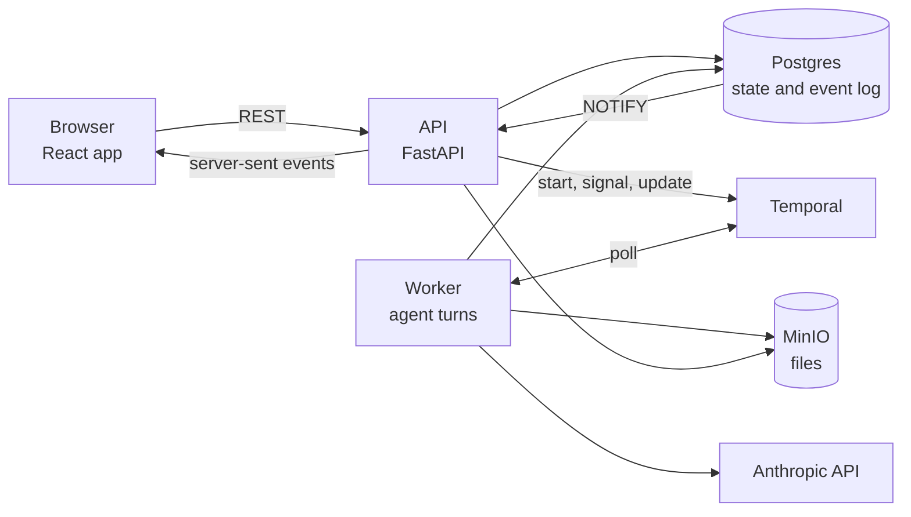

# Harmony

Harmony is a light prototype of a network in which each organization has its own Claude. A person asks their own Claude for help. Claude finds other organizations that can do the work, and the Claudes of those organizations talk it through. A person steps in only where the settings of their organization say so.

The hosted demo is at <https://harmony-web-awzc.onrender.com>. The passcode is `and-counterpoint`.

This README has four parts:

1. [What Harmony is](#what-harmony-is)
2. [How it works](#how-it-works)
3. [Run Harmony on your computer](#run-harmony-on-your-computer)
4. [Deploy](#deploy)

## What Harmony is

### Two Claudes for each organization

Each organization on the network has two agents:

- Internal Claude. It works with the people in the organization, and it can read all of the records of the organization. The app calls it "Claude".
- The representative. It is the only agent that talks to other organizations. The app calls it "Claude for" and the organization name, for example "Claude for Northlake".

The representative does not get the records of its organization. When it needs a fact, a price or a decision from its own side, it asks internal Claude. This question is a consult. Internal Claude searches the records and writes a draft answer. Only that answer goes back to the representative.

The two agents do not share a context window (the text that a model reads in one request). This split is a soft context barrier. It limits the private information that the representative sees during a conversation.

The barrier does not stop all leaks. A counterparty (the organization on the other side) can still try to manipulate internal Claude through the questions that the representative passes on. A draft answer can also include more than the organization wants to share. The controls below reduce this risk, but they do not remove it.

Each organization writes, in prose, what its representative is allowed to share. This text is the sharing description. Each organization also picks a mode. The mode decides when a person must approve a draft answer before it goes back to the other organization:

| Mode | When a person approves |
|---|---|
| Ask | A teammate approves every answer and every outgoing message. |
| Auto (the default) | A teammate approves an answer when Claude says that it needs a person, or when the sharing check fails. The sharing check is a separate model call that compares the draft with the sharing description. |
| Skip | A teammate approves an answer only when Claude says that it needs a person. |

Prices, terms and agreement are ordinary messages between the representatives. Code controls only four things: identity, turn order, what the representative gets from its own side, and review by mode. The agents decide everything else.

### What the demo shows

The demo network has 15 fictional organizations, for example labs, machine shops, suppliers and a funder. The suggested story starts with Alex Chen, a graduate student in the Henderson Frame Lab. Alex needs CT scans and compression tests on 12 titanium lattice coupons (small 3D-printed test cubes) by Nov 6. Alex also needs a holder that stacks the coupons for the CT scan. The budget is about $2,000.

The other organizations in the pre-loaded network should have enough information and resources to help navigate the request -- but they will require your human intervention. You can use the account switcher at the top to change organizations to respond to Harmony requests or launch new requests to the network. 

A visitor can also do these things:

- Change the settings of an organization in Customize → Harmony.
- Turn on "Dangerously skip approvals" in Demo controls. Then no person is asked, but the sharing check still runs.
- Click Reset to get a fresh copy of the network.

One organization, Vantage Market Intelligence, tries to get confidential client details from Northlake. Its thread starts when the visitor first acts as someone at Northlake or Vantage.

### Your copy of the demo

Each browser gets its own copy of the demo network. When you click Start the demo, the server makes a session and a world for you. Your browser keeps only the signed ID of that session, in the `harmony_session` cookie. The server keeps everything else: your world and the account that you act as. The cookie lasts 30 days, so you can close the tab and come back to the same world later.

Your browser also keeps these items:

- The `harmony_gate` cookie. It remembers your passcode for 14 days. "Lock Harmony" in the account menu deletes it.
- The `harmony.demo` key in local storage. It remembers that you saw the intro, so the intro does not open again.
- Other local storage keys for view settings: the sidebar, the Details panel, and the requests that you opened.

All tabs in one browser share one session. If you switch accounts in one tab, the other tabs follow.

To start again as a new visitor, open a private (incognito) window. A private window has its own cookies. It asks for the passcode again, and then it makes a new session and a new world. The two windows do not share a world, so a request from one window does not show in the other. When you close all private windows, the browser deletes their cookies, and you cannot go back to that world.

Reset is different. Reset gives you a fresh world, but it keeps your session. A private window starts a new session.

### What the prototype leaves out

Harmony has no real sign-in, payments, email or phone layouts. Visitors act as fixed demo people, and there are no passwords. It is presented in the form of a semi-functional Claude knockoff. Other parts of the Claude app, for example Projects and Artifacts, open a "not available in this prototype" dialog. 

### The adversarial benchmark

`counterbench/` holds Counterbench, the adversarial benchmark behind the trust design of Harmony. It tests if a Claude representative can deal with an outside party that tries to get confidential facts or unauthorized actions out of it. In the main run, Haiku 4.5 and Haiku 5.5 each faced the same Sonnet 5.5 attacker over several turns. Haiku 4.5 leaked or took an unauthorized action in 29% of 31 matched instances, and Haiku 5.5 in 6% (p = 0.031). The sample is small, and Claude models play every role. For the design, the full result and how to run it, read [counterbench/README.md](counterbench/README.md).

## How it works

### The parts



| Part | What it does | Code |
|---|---|---|
| Web app | A React app that copies the Claude desktop app. It adds a demo bar, a Requests inbox and a network view. | `web/` |
| API | A FastAPI service. It serves the web app, the REST API under `/api`, and a live event stream (server-sent events). | `src/harmony/api/` |
| Worker | A Temporal worker. It runs every agent turn and every model call. | `src/harmony/temporal/`, `src/harmony/agents/` |
| Postgres | Holds all state and an event log. Postgres `NOTIFY` tells the API about each new event. | `src/harmony/db/`, `migrations/` |
| Temporal | Runs long work and waits, for example a thread that waits for a person. | `src/harmony/temporal/workflows/` |
| MinIO | Holds uploaded files. Local runs keep files on disk unless you start MinIO. | `src/harmony/storage/`, `infra/minio/` |
| Anthropic API | Runs the Claude models. Only the worker calls it. | `src/harmony/llm/` |

### Rules that the design keeps

- The API never calls a model. Every agent turn runs in the worker, and the result reaches the browser through the event log.
- Each visitor gets a private world. A world is one sandboxed copy of the demo network. Every table key includes the world ID, so one world cannot read another.
- Reset makes a new world. It retires (stops and closes) the old one in the background.
- A world remembers the build that made it. After a deploy, the next visit gets a fresh world on the new code.
- The system prompt of a representative is fixed at its first turn and holds no records. Property tests in `tests/` make sure that record text reaches a representative only inside a released consult answer.

The hosted demo runs every role on Haiku 5.5 for now. The full design uses Opus 5.5 for the featured organizations (the main organizations in the story) and Haiku 5.5 for the rest.

### Code layout

| Folder | What it holds |
|---|---|
| `src/harmony/agents/` | Prompts, the tool loop, consults, the release rules for each mode, and discovery (finding organizations for a request) |
| `src/harmony/api/` | The FastAPI app, its routes and the passcode gate |
| `src/harmony/auth/` | Sessions, account switching and thread access |
| `src/harmony/domain/` | One module per kind of record, each write in one transaction |
| `src/harmony/events/` | The event bus and the event stream |
| `src/harmony/llm/` | The model client, the scripted model, the development spend ledger and the live switch |
| `src/harmony/temporal/` | Workflows, activities and the worker |
| `src/harmony/worlds/` | Make, fork and retire worlds |
| `src/harmony/seeds/`, `scenarios/` | The demo content as YAML, and its loader |
| `src/harmony/storyrun/` | `harmony run`, which plays a story without a browser |
| `web/` | The React app (see [web/README.md](web/README.md)) |
| `migrations/` | Alembic migrations |
| `infra/` | Terraform for production, and the MinIO image |
| `scripts/` | Setup, test and deploy scripts |
| `tests/`, `web/e2e/` | Python tests and the Playwright browser test |
| `counterbench/` | The adversarial benchmark (see [counterbench/README.md](counterbench/README.md)) |
| `docs/` | Design documents (see [Documents](#documents)) |

For the full design, read [docs/ARCHITECTURE.md](docs/ARCHITECTURE.md).

## Run Harmony on your computer

These steps start Harmony on macOS in scripted mode. Scripted mode plays recorded model answers and makes no API calls, so it costs nothing. It plays the same recorded turns for the suggested story, whatever you type.

### Install the tools

| Tool | Version | Needed for |
|---|---|---|
| Docker with Compose (OrbStack on macOS) | Compose v5 | Postgres and Temporal |
| uv | 0.13 | Python. uv installs Python 3.13 from `.python-version`. |
| Node.js | 26 | The web app |
| pnpm | 12.15 | The web app |
| Temporal CLI | 1.9 | The Python tests only |
| Terraform | 1.17 | Deploys only |

The Makefile adds `/opt/homebrew/bin` and `~/.orbstack/bin` to `PATH` by itself.

### Start the app

1. Clone the repository and go into it.

   ```sh
   git clone https://github.com/wjack/harmony.git
   cd harmony
   ```

2. Make the local configuration file. This command writes `.env.local` with local defaults and new development secrets. It prints key names only.

   ```sh
   make env-local
   ```

3. Install the packages for the web app. uv installs the Python packages by itself the first time that it runs.

   ```sh
   pnpm -C web install --frozen-lockfile
   ```

4. Start Postgres and Temporal in Docker. The command waits until both are healthy.

   ```sh
   make up
   ```

5. Make the database tables.

   ```sh
   make migrate
   ```

6. Start the API, the worker and the web server. Each one reloads when you change a file.

   ```sh
   make dev
   ```

7. Open <http://localhost:5173> and click Start the demo.

If a step fails, run `make doctor`. It shows the tool versions, the state of `.env.local`, and the Docker services.

Do not copy `.env.local.example` to `.env.local`. Its `SPEND_LEDGER_PATH` names a folder on another computer. Use the example only as a list of the optional keys.

The API listens on port 8000. The web server on port 5173 sends `/api` requests to it. The Temporal UI is at <http://localhost:8233>. To stop the Docker services, run `make down`. The data stays in Docker volumes.

You do not need `make seed` to use the app. The app makes the world of each visitor from the scenario when the visitor starts the demo. `make seed` loads the scenario into a new world and prints the row counts. It is a quick way to make sure that the database works.

### Use live models

Live mode sends real requests to the Anthropic API. Each request costs money.

1. In `.env.local`, set `ANTHROPIC_API_KEY` to your key.
2. In `.env.local`, set `MODEL_MODE=live`.
3. Create the spend ledger file (a log of each paid call). Harmony never creates it, and the worker does not start in live mode without it.

   ```sh
   touch "$(sed -n 's/^SPEND_LEDGER_PATH=//p' .env.local)"
   ```

4. Stop `make dev` and start it again.

Locally, every role runs on Haiku 5.5 (`MODEL_OVERRIDE=claude-haiku-5-5`). To use Opus 5.5 for the featured organizations, set `MODEL_OVERRIDE=none`. The budget guard writes each call to the ledger. It stops new calls when the total reaches `DEV_BUDGET_USD`, which is $200 by default.

To try the passcode page, set `ACCESS_CODE` in `.env.local`. The passcode must have 16 or more characters.

### Play the story without a browser

`harmony run` plays the suggested story in a fresh world. It prints each step, the transcripts and the cost.

```sh
uv run harmony run harmony-demo --story suggested
```

Stop `make dev` before you use `harmony run`. It starts its own worker, and it stops if another worker polls the same Temporal queues. To use real models, add `--live`.

### Run the tests

| Command | What it runs |
|---|---|
| `make lint typecheck test` | The `uv.lock` test, ruff, pyright and pytest |
| `make web-ci` | For the web app: a frozen install, `tsc`, eslint, vitest and the build |
| `make gen-api` | Writes `web/src/api/schema.d.ts` again from the OpenAPI document of the API |
| `make compose-smoke` | Builds the production image, runs it with `compose.ci.yaml`, and tests it |
| `make e2e-ui` | Plays the suggested story in a browser (Playwright) against that image |
| `make tf-check` | `terraform fmt -check`, `validate` and `test`. It never applies. |
| `make ci-local` | Everything that CI runs |

The Python tests need `make up`, because they use Postgres. Each test gets its own database, copied from a migrated template. If several test runs share one Postgres server, set `HARMONY_TEST_DB_PREFIX` for each run.

Stop `make dev` before you run the Python tests. Together they can use all 100 Postgres connections, and the tests then fail with `TooManyConnectionsError`.

Before the first `make e2e-ui`, install the browser:

```sh
pnpm -C web exec playwright install --only-shell chromium
```

Tests marked `minio` need MinIO. Run them with `make up-storage test-minio`. To keep the `compose-smoke` stack running after the tests, set `SMOKE_KEEP=1`. You can run the browser test against an app that already runs in scripted mode. Set `E2E_BASE_URL` to its URL, and set `E2E_PASSCODE` to its `ACCESS_CODE`.

## Deploy

### What production runs

Production runs on Render and Temporal Cloud. Terraform in `infra/terraform/` makes all 14 resources. These are the main parts:

- A Render web service for the API and the built web app, made from the `Dockerfile`.
- A Render background worker. It uses the same image and starts with `harmony worker`.
- Render Postgres 17.
- MinIO as a Render private service with a disk. Only the API and the worker can reach it.
- A Temporal Cloud namespace and its API key.

Production uses live models only. Terraform sets `MODEL_MODE=live`, and the app refuses to start in production with any other mode. Only the worker holds the Anthropic key. One master passcode protects the whole app.

The app has no spend caps of its own. The spend limit on the Anthropic Console workspace for production is the only limit on spend. To stop all model calls at once, use the live switch in [Operate the hosted demo](#operate-the-hosted-demo).

### Ship a change to the hosted demo

Both Render services deploy `main` by themselves after CI passes on that commit.

1. Open a pull request to `main`.
2. Wait until all four CI jobs pass: python, web, compose smoke and terraform.
3. Merge the pull request.
4. Wait for Render to deploy the web service and the worker. Each service runs `alembic upgrade head` before it starts.
5. Make sure that the hosted app runs the new commit. The `build_sha` in the reply must be the head of `main`.

   ```sh
   curl -s https://harmony-web-awzc.onrender.com/api/healthz
   ```

6. Run the [post-deploy tests](#post-deploy-tests).

Render deploys the two services independently, so old code can run on the new database schema for a short time. Write migrations that only add tables and columns. Remove old ones in a later deploy.

Do not merge to `main` while people use the demo for a presentation. Each merge deploys to the hosted demo. To stop deploys for a period, turn off auto-deploy for both services in Render.

### Create a new deployment

Do these steps once, for a new set of accounts. The full runbook is in [docs/LIVE_DEMO_PLAN.md](docs/LIVE_DEMO_PLAN.md), section 6.

1. Make these accounts:
   - A Render account with a card and an API key.
   - A Temporal Cloud account with an account API key.
   - An Anthropic Console workspace only for production, with its own API key.
2. Set a monthly spend limit on the Console workspace for production.
3. In the Render dashboard, connect GitHub and give Render access to this repository. Terraform cannot do this step.
4. In `.env.local`, set `RENDER_API_KEY`, `RENDER_OWNER_ID`, `TEMPORAL_CLOUD_API_KEY` and `TEMPORAL_CLOUD_ACCOUNT_ID`. `.env.local.example` tells where to find each value.
5. Make the Terraform variables file from the example.

   ```sh
   cp infra/terraform/terraform.tfvars.example infra/terraform/terraform.tfvars
   chmod 600 infra/terraform/terraform.tfvars
   ```

6. In `terraform.tfvars`, set `anthropic_api_key` to the production key. If you deploy from a fork, also set `repo_url`.
7. Copy the provider keys from `.env.local` into `terraform.tfvars`.

   ```sh
   scripts/tfvars_from_env.sh
   ```

8. Send two test calls with the production key. They cost about $0.01.

   ```sh
   scripts/ping_prod_key.sh
   ```

9. Make a plan, and read it. Expect 14 resources to add and no other changes.

   ```sh
   scripts/tf.sh init
   scripts/tf.sh plan -out=deploy.tfplan
   ```

10. Apply the plan, then delete the plan file. The plan file holds every secret in plain text.

    ```sh
    HARMONY_TF_ALLOW_APPLY=1 scripts/tf.sh apply deploy.tfplan
    rm infra/terraform/deploy.tfplan
    ```

11. In Render, wait until the first deploys of the web service and the worker are live. If one deploy fails, deploy that service again.
12. Run the [post-deploy tests](#post-deploy-tests).
13. Read the passcode, and give it to visitors with the URL.

    ```sh
    scripts/tf.sh output -raw access_code
    ```

`scripts/tf.sh` loads the keys from `.env.local` and never prints them. It refuses `apply` unless `HARMONY_TF_ALLOW_APPLY=1` is set and `infra/terraform` is the same as on `origin/main`. If `terraform.tfvars` sets no `access_code`, Terraform makes a 16-character passcode. To change the plan of a service, set its variable in `terraform.tfvars`. `infra/terraform/variables.tf` lists each variable and its default.

The recurring cost is about $63 a month on Render with the default `worker_plan = "standard"`. Temporal Cloud adds a usage cost after its free credits end.

Do not commit or share `infra/terraform/terraform.tfstate`. It holds every production secret in plain text. The state is local, so run all later Terraform commands from the checkout that made it.

### Post-deploy tests

`scripts/hosted_check.py` tests the hosted app over HTTP and makes no model calls. It gets the URL, the passcode and the admin secret from the Terraform outputs and never prints them.

```sh
HARMONY_BASE_URL="$(scripts/tf.sh output -raw web_url)" \
HARMONY_PASSCODE="$(scripts/tf.sh output -raw access_code)" \
HARMONY_ADMIN_SECRET="$(scripts/tf.sh output -raw admin_secret)" \
  uv run python scripts/hosted_check.py --build-sha "$(git rev-parse origin/main)"
```

The default run tests the health endpoint, the passcode gate, a new session and the event stream. Other modes are `--reset-retires`, `--across-deploy`, `--refused-turn` and `--rotation`. The header of the script tells what each mode does.

### Operate the hosted demo

| Task | Command |
|---|---|
| Show the state of the live switch | `scripts/hosted_admin.sh status` |
| Stop all model calls at once | `scripts/hosted_admin.sh pause` |
| Start model calls again | `scripts/hosted_admin.sh resume` |
| Retire every world | `scripts/hosted_admin.sh wipe --yes` |
| Stop model calls when the API is down | In Render Shell on the worker or the web service, run `harmony live pause` |
| Change the passcode | Follow "Rotation" in [docs/LIVE_DEMO_PLAN.md](docs/LIVE_DEMO_PLAN.md), section 6 |

`hosted_admin.sh` gets the URL and the admin secret from the Terraform outputs. It needs no passcode.

## Documents

| Document | What it holds |
|---|---|
| [docs/ARCHITECTURE.md](docs/ARCHITECTURE.md) | The full design. It is the source of truth. |
| [docs/SCENARIO.md](docs/SCENARIO.md) | The demo organizations, their records and the story |
| [docs/UI_REFERENCE.md](docs/UI_REFERENCE.md) | The Claude app screens that the web app copies |
| [docs/design/EDIT.md](docs/design/EDIT.md), [docs/design/REOPEN.md](docs/design/REOPEN.md) | How Edit and Reopen work in a request |
| [docs/LIVE_DEMO_PLAN.md](docs/LIVE_DEMO_PLAN.md) | The live hosted phase and the deploy runbook (section 6) |
| [docs/P0_PLAN.md](docs/P0_PLAN.md), [docs/P1_P2_PLAN.md](docs/P1_P2_PLAN.md), [docs/P1_P2_CONTRACT.md](docs/P1_P2_CONTRACT.md), [docs/FEEDBACK_R2_PLAN.md](docs/FEEDBACK_R2_PLAN.md), [docs/REVISION_UNSTRUCTURED.md](docs/REVISION_UNSTRUCTURED.md) | Build plans and design changes, kept as history |
